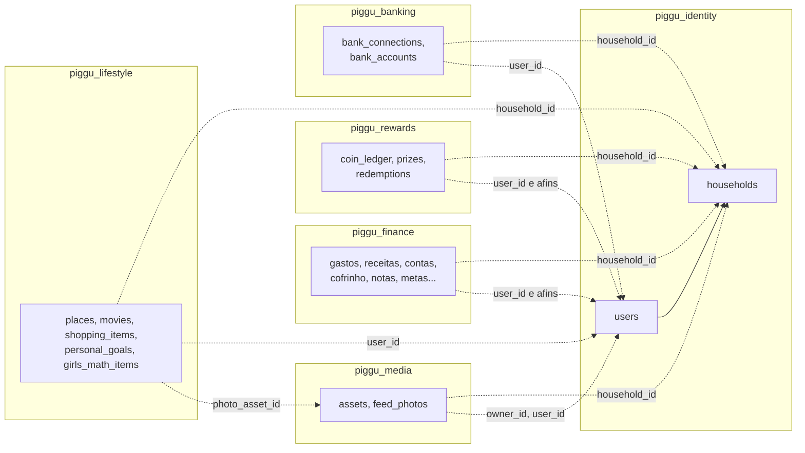
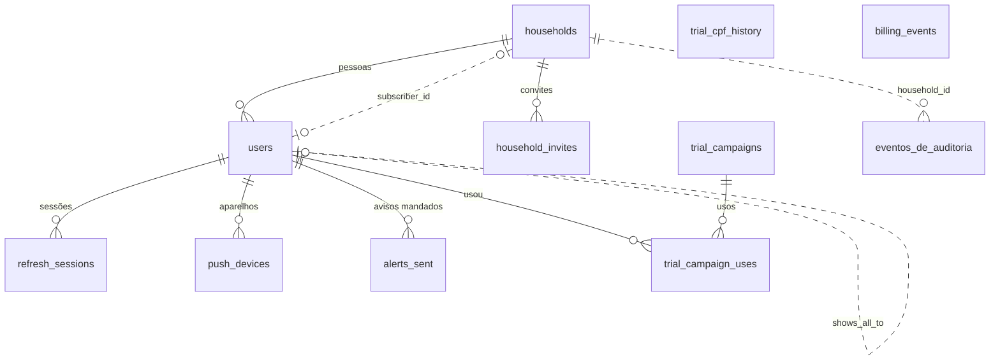
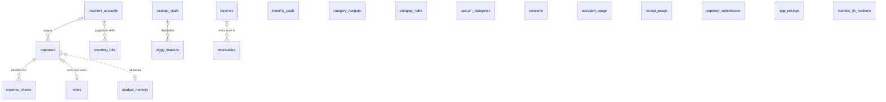
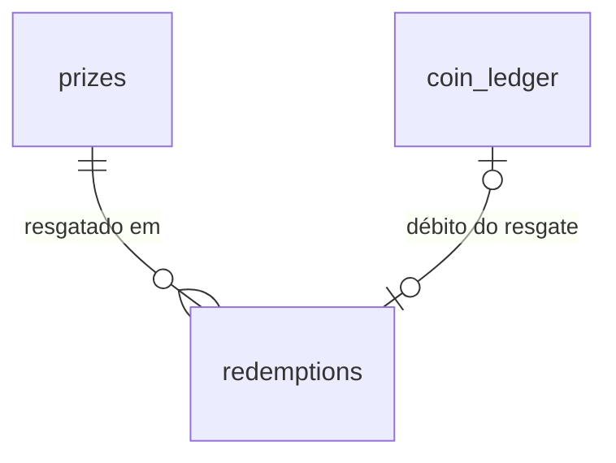
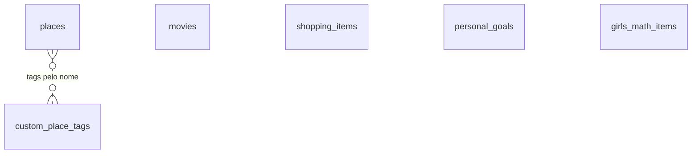
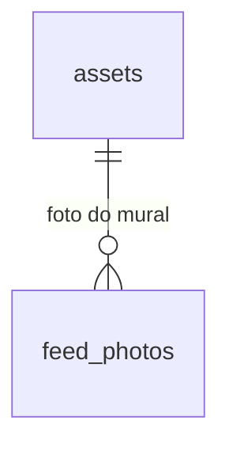
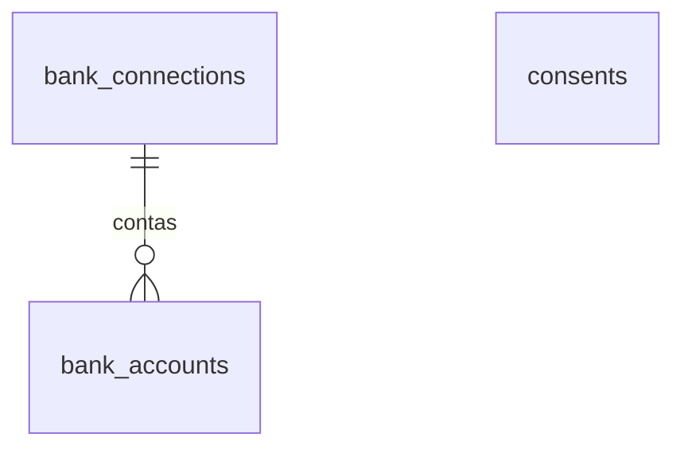

# Modelo de dados do Piggu

**Atualizado em 26/10/2026.** Esquema depois de todas as 76 migrações:

| Serviço | Banco | Até a migração |
|---|---|---|
| identity | `piggu_identity` | V36 (`push_no_android`) |
| finance | `piggu_finance` | V21 (`indices_nas_chaves_estrangeiras`) |
| rewards | `piggu_rewards` | V4 (`indices_nas_chaves_estrangeiras`) |
| lifestyle | `piggu_lifestyle` | V5 (`cada_um_ve_o_seu`) |
| media | `piggu_media` | V4 (`indices_nas_chaves_estrangeiras`) |
| banking | `piggu_banking` | V6 (`consentimento_retirado`) |

Este documento foi escrito a partir do esquema real: um Postgres 16 descartável, as migrações
Flyway de `backend/<serviço>/src/main/resources/db/migration` aplicadas em ordem e o resultado
lido com `pg_dump --schema-only`. As regras vêm do código Java e do
[`backend/README.md`](../backend/README.md). Para regenerar o esquema (só precisa do Docker):

```bash
bash scripts/esquema-do-banco.sh            # grava /tmp/piggu-esquema-do-banco/<serviço>.sql
```

Entrou migração nova? Rode o script, compare com as tabelas abaixo e atualize a linha do topo.

Quem lê: quem vai escrever os apps nativos (SwiftData no iOS, Room no Android, que guardam
parte destes dados no aparelho) e qualquer sessão futura do Claude.

---

## Sumário

1. [Visão geral](#visão-geral)
2. [Como os bancos se ligam](#como-os-bancos-se-ligam)
3. [Famílias, papéis e quem vê o quê](#famílias-papéis-e-quem-vê-o-quê)
4. [identity](#identity-piggu_identity)
5. [finance](#finance-piggu_finance)
6. [rewards](#rewards-piggu_rewards)
7. [lifestyle](#lifestyle-piggu_lifestyle)
8. [media](#media-piggu_media)
9. [banking](#banking-piggu_banking)
10. [Regras que moram nos dados](#regras-que-moram-nos-dados)
11. [No aparelho (apps nativos)](#no-aparelho-apps-nativos)
12. [Coisas que achei](#coisas-que-achei)

---

## Visão geral

- **Um banco Postgres por serviço**, cada um com o próprio usuário (`piggu_finance` só entra no
  `piggu_finance`, e assim por diante; `backend/db/init/01-criar-bancos.sh`). Um serviço não
  lê a tabela de outro.
- **Não há chave estrangeira entre bancos.** A ligação é por id: o `household_id` de um gasto é
  o `id` de uma linha de `households` no identity, mas o banco do finance não sabe disso.
  Quem garante a coerência é o código (o id da família vem no token) e a exclusão em cascata
  pelos serviços (veja [Exclusão da conta](#exclusão-da-conta-em-cascata)).
- **Ids são UUID.** A maioria nasce no Java (`UUID.randomUUID()`); o `DEFAULT gen_random_uuid()`
  das tabelas é só rede de segurança. A exceção é `eventos_de_auditoria.id`, um `bigint` que o
  banco numera.
- **Toda tabela de domínio tem `household_id`** (a família dona, obrigatório) e quase todas têm
  a coluna de quem lançou (`user_id` na maioria; `created_by_id`, `updated_by_id`, `actor_id`,
  `owner_id`, `member_id` ou `autor_id` em algumas). Ela é opcional porque fica nula quando a
  pessoa sai da família e o registro fica com a família.
- **Textos opcionais costumam ser `''` em vez de nulo** (por exemplo `merchant`, `comment`,
  `brand`). Herança da planilha do Apps Script; trate vazio como "não informado".
- **Mês de referência é texto `AAAA-MM`** (`varchar(7)`, com `CHECK` no formato) em metas,
  orçamento de IA, leituras de nota e mural. A exceção é `personal_goals.month`, que é uma
  `date` sempre no dia 1.
- **Datas**: `date` para o dia do fato (dia do gasto, do depósito, da visita) e `timestamptz`
  para o momento em que algo aconteceu no sistema. O dia vira no horário de Brasília
  (`America/Sao_Paulo`).

**Colunas técnicas, iguais em todas as tabelas e omitidas abaixo:** `id` (uuid, chave),
`household_id` (uuid, obrigatória, família dona), `created_at` e `updated_at` (`timestamptz`,
preenchidas pelo banco ou pelo Java). Não existe coluna de versão: nenhuma entidade usa
`@Version`, então duas edições do mesmo registro ao mesmo tempo ficam com a última que chegou.

---

## Como os bancos se ligam

Linha cheia: chave estrangeira de verdade, dentro do mesmo banco. Linha tracejada: ligação só
por id, entre bancos, que o banco não confere.



| De | Coluna | Aponta para | Observação |
|---|---|---|---|
| Todas as tabelas de domínio | `household_id` | `identity.households.id` | Vem da claim `familia` do token |
| Quase todas | `user_id`, `member_id`, `actor_id`, `owner_id`, `created_by_id`, `updated_by_id`, `autor_id` | `identity.users.id` | Vem do `sub` do token |
| `lifestyle.places`, `lifestyle.girls_math_items` | `photo_asset_id` | `media.assets.id` | O lifestyle chama o media para gravar e apagar a foto |
| `banking.bank_connections` | `pluggy_item_id` | Item na Pluggy | Fora do Piggu |

Só duas conversas entre serviços tocam em dados: o lifestyle chama o media para guardar a foto
de um lugar ou de um item do Girls Math, e o identity chama `/api/meus-dados` de cada serviço
para exportar ou apagar a conta. O resto passa pelo app.

---

## Famílias, papéis e quem vê o quê

### A família isola tudo

Cada pessoa tem uma conta (`users`) e pertence a exatamente uma família (`households`). O
primeiro login cria a conta e uma família nova, com a pessoa como `TITULAR`. Quem aceita um
convite (`household_invites`, vale 7 dias) entra como `MEMBRO`; o titular pode promovê-lo a
`PARCEIRO`. No plano casal vigente, se a casa ainda não tem parceiro (nem convite de parceria
esperando), quem aceita o convite e não é menor de idade já entra como `PARCEIRO`. Se depois
informar uma data de nascimento de menor, volta a `MEMBRO` (D-086).

O id da família vai no token (claim `familia`). Nos cinco serviços de domínio, toda entidade
marca `household_id` com `@TenantId`: o Hibernate filtra **toda** consulta pela família do
token e preenche a coluna ao gravar (`FamiliaAtual` no `piggu-common`). Sem token, a sessão cai
numa família que não existe e não vê nada. Consulta em SQL puro **não** passa por esse filtro,
então todo SQL nativo escreve `household_id = ?` à mão. Os testes `IsolamentoEntreFamiliasTest`
de cada serviço provam que uma família nunca lê nem altera dado de outra.

### Papéis (`users.role`)

| Papel | O que faz |
|---|---|
| `ADMIN` | Opera a instalação (`/api/users`); dentro da própria família vale como titular. Vem de `PIGGU_ADMIN_EMAILS` |
| `TITULAR` | Dono da família: convida, remove pessoas, assina o Premium |
| `PARCEIRO` | Promovido pelo titular, ou o convidado que entra no plano casal (D-086). Junto com o titular forma "o casal" (os responsáveis) |
| `MEMBRO` | Convidado: usa todas as telas, cada um com os próprios dados |

### Dentro da família, cada um vê o seu

O filtro de família é a primeira camada. A segunda é o filtro de dono (`DonoAtual`), também
automático no Hibernate:

| Regra | Tabelas | Quem vê |
|---|---|---|
| Dono ou compartilhado | `expenses`, `incomes`, `recurring_bills`, `payment_accounts`, `savings_goals` | Quem lançou, todos da família quando `shared = true`, e quem tem permissão de ver o dono (abaixo). Gasto: também quem está na divisão (`expense_shares`) |
| Só o dono | `notes`, `receivables`, `places`, `movies`, `shopping_items`, `feed_photos`, `assets` | Quem lançou e quem tem permissão de ver o dono |
| Só a pessoa, nem o casal | `monthly_goals`, `category_budgets`, `category_rules`, `product_memory` | Só quem lançou. São preferências de quem lança |
| Privado | `personal_goals`, `girls_math_items`, `assets` com `context = 'GIRLS_MATH'` | Só a dona. O serviço filtra por `user_id`; para os outros, o registro "não existe" |
| Da família inteira | `custom_categories`, `custom_place_tags`, `coin_ledger`, `prizes`, `redemptions` | Todos da família |
| Da conexão | `bank_connections`, `bank_accounts` | Só quem conectou o banco |

"Quem tem permissão de ver o dono" é a lista `tambemVe` que o identity põe no token do titular
e do parceiro (`TokenService.tambemVisiveis`):

- os **menores** da família (13 a 17 anos, pela `users.birth_date`; maioridade aos 18);
- o **outro responsável**, só se ele escolheu mostrar tudo para esta conta
  (`users.shows_all_to` guarda **para quem** a pessoa mostra tudo; trocar de parceiro não herda
  a permissão do anterior).

Sem isso, o casal vê um do outro só o que foi marcado como compartilhado. Registro sem dono (de
antes de cada um ter os seus, ou de quem saiu) fica visível para titular e parceiro. Mudou o
papel, a idade ou a escolha? Vale na próxima renovação do token (até 5 minutos).

Por cima de tudo, gastos e receitas aceitam o parâmetro `visao` (`VisaoAtual`): `TUDO` (padrão),
`MEU` (só o que a pessoa lançou) ou `CASAL` (só o compartilhado). Ele só reduz o que aparece.

Quem pode **mexer** num registro: quem lançou e, para os responsáveis, quem está na lista
`tambemVe` (`CurrentUser.podeGerenciar`). Compartilhar ou deixar de compartilhar é só de quem
lançou.

### O plano também é da família

`households.premium_until` diz até quando o Premium vale (passou da data, acabou, sem job). O
`plan_kind` diz quem da casa fica Premium: `INDIVIDUAL` (só `subscriber_id`), `CASAL` (titular
e parceiro) ou `FAMILIA` (todos, até 5 pessoas). O plano de cada pessoa vai no token (claim
`plano`), e os outros serviços barram o Premium sem perguntar ao identity.

---

## identity (`piggu_identity`)

Contas, famílias, sessões, assinatura, avisos e a trilha de auditoria das mudanças na família.
É o único banco com dado de identificação (e-mail, nome, CPF cifrado, telefone).



### `households` — família

| Coluna | Tipo | Obrigatória | O que é |
|---|---|---|---|
| `name` | texto(120) | sim (padrão `''`) | Nome da família |
| `premium_until` | timestamptz | não | Até quando o Premium vale; nulo ou no passado é gratuito |
| `premium_since` | timestamptz | não | Quando a assinatura começou |
| `first_charge_at` | timestamptz | não | Primeira cobrança paga; o prazo de arrependimento (CDC art. 49) conta daqui, não do teste grátis |
| `plan_source` | texto(20) | não | De onde veio a assinatura: `WEB` (Stripe), `APP_STORE` ou `PLAY_STORE` (RevenueCat); nulo é teste ou cortesia |
| `plan_kind` | texto(20) | sim (padrão `INDIVIDUAL`) | `INDIVIDUAL`, `CASAL` ou `FAMILIA` |
| `subscriber_id` | uuid | não | Conta que assinou (`users.id`) |
| `billing_event_at` | timestamptz | não | Momento do último aviso do provedor aplicado; aviso mais velho que este é ignorado |

### `users` — conta de uma pessoa

E-mail único. `household_id` é chave estrangeira para `households`.

| Coluna | Tipo | Obrigatória | O que é |
|---|---|---|---|
| `email` | texto(320) | sim, única | E-mail em minúsculas; é o login |
| `role` | texto(20) | sim | `ADMIN`, `TITULAR`, `PARCEIRO` ou `MEMBRO` |
| `active` | boolean | sim (padrão `true`) | Conta ativa |
| `deactivated_at` | timestamptz | não | Desde quando está desativada (a retenção conta daqui) |
| `last_login_at` | timestamptz | não | Último acesso (a retenção conta daqui) |
| **Nome e foto** | | | |
| `nickname` | texto(120) | não | Apelido; tem preferência na hora de mostrar o nome |
| `google_name`, `first_name` | texto(120), texto(80) | não | Nome e primeiro nome vindos do Google, atualizados a cada login |
| `google_picture` | texto(1000) | não | URL da foto do Google |
| `foto_propria` | text | não | Foto escolhida pela pessoa: data URL `data:image/jpeg;base64,...`, quadrada, sem metadados |
| `sem_foto` | boolean | sim (padrão `false`) | A pessoa tirou a foto: aparecem as iniciais, nem a do Google |
| `birth_date` | date | não | Nascimento; decide se é menor de idade (13 a 17) |
| **Login** | | | |
| `password_hash` | texto(100) | não | BCrypt da senha; nulo é conta que só entra pelo Google |
| `password_failures`, `password_locked_until` | integer, timestamptz | sim / não | Senhas erradas seguidas; cinco travam a entrada por senha por 15 minutos |
| `email_verified` | boolean | sim (padrão `false`) | E-mail provado (pelo Google ou pelo link) |
| `email_token_hash`, `email_token_expires_at` | texto(64), timestamptz | não | SHA-256 do link de confirmação ainda não usado |
| `password_reset_hash`, `password_reset_expires_at` | texto(64), timestamptz | não | SHA-256 do link de "esqueci minha senha" ainda não usado |
| **Documento e contato** | | | |
| `cpf_cifrado` | texto(200) | não | CPF cifrado (`CofreDeCpf`) |
| `cpf_indice` | texto(64) | não, única quando preenchida | HMAC do CPF: uma pessoa, uma conta (V35) |
| `cpf_informado_em` | timestamptz | não | Quando o CPF foi informado |
| `country` | texto(2) | não (padrão `BR`) | País onde mora (ISO 3166); nulo só em conta antiga |
| `id_doc_type`, `id_doc_cifrado`, `id_doc_indice`, `id_doc_informado_em` | | não | Documento de outro país (NIF, DNI...), só em conta antiga |
| `phone` | texto(16) | não | Celular em E.164 (`+5511999998888`), ainda sem prova por SMS |
| **Preferências** | | | |
| `currency` | texto(3) | sim (padrão `BRL`) | Moeda em que a pessoa vê os valores (ISO 4217) |
| `conversion_currency` | texto(3) | sim (padrão `USD`) | Moeda da cotação no topo |
| `quote_currency` | texto(3) | sim (padrão `BRL`) | Outra ponta da cotação no topo |
| `show_exchange_rate` | boolean | sim (padrão `true`) | Mostra a cotação no topo |
| `timezone` | texto(50) | sim (padrão `America/Sao_Paulo`) | Fuso (IANA) |
| `locale` | texto(10) | sim (padrão `pt-BR`) | Idioma da interface |
| `lifestyle_modules` | texto(200) | não | Telas de estilo de vida no menu, separadas por vírgula (`compras,lugares,filmes,fotos,premios,girls-math`). Nulo liga todas; vazio, nenhuma |
| `alerts_by_email`, `alerts_by_push` | boolean | sim (padrão `false`) | Avisos fora do app (fatura, orçamento, conta fixa) |
| `shows_all_to` | uuid | não | Para quem a pessoa mostra tudo o que lança (o parceiro) |
| `shares_by_default` | boolean | sim (padrão `false`) | Lançamentos novos começam como compartilhados |
| `permissions` | jsonb | sim (padrão `{}`) | Herança do Apps Script; hoje só é lido (veja [Coisas que achei](#coisas-que-achei)) |
| **Assinatura e termos** | | | |
| `trial_used_at` | timestamptz | não | Quando usou o teste grátis; nulo ainda pode usar |
| `stripe_customer_id` | texto(255) | não, única | Cliente na Stripe, para abrir o portal |
| `terms_version`, `terms_accepted_at` | texto(20), timestamptz | não | Versão dos termos aceita e quando |
| `partner_invited_at` | timestamptz | não | Quando o titular convidou para ser parceiro; vira parceiro ao aceitar |

### Demais tabelas do identity

| Tabela | Colunas além das técnicas | O que é |
|---|---|---|
| `household_invites` | `email` (texto(320)), `invited_by` (uuid), `expires_at` | Convite para entrar na família. Único por família e e-mail; vale 7 dias e a retenção apaga os vencidos |
| `refresh_sessions` | `user_id`, `token_hash` (texto(64), único), `user_agent`, `expires_at`, `revoked_at`, `remember` | Sessão longa (30 dias). Só o SHA-256 do refresh token; rotacionado a cada uso. `remember` é o "continuar conectado" |
| `push_devices` | `token` (chave, texto(512)), `user_id`, `platform` | Aparelho que recebe push: `IOS` (token do APNs, em minúsculas) ou `ANDROID` (token do FCM, como veio). O lembrete diário envia para `IOS` pelo APNs e para `ANDROID` pelo FCM; token recusado é apagado |
| `alerts_sent` | `user_id`, `alert_key` (chave composta), `sent_at` | Avisos já mandados, pela chave que o finance dá a cada um: o mesmo aviso não chega duas vezes. Sai depois de 120 dias |
| `billing_events` | `event_id` (chave), `provider`, `received_at` | Avisos de pagamento já processados (Stripe, RevenueCat): cada um conta uma vez |
| `trial_campaigns` | `code` (chave), `trial_days`, `starts_at`, `ends_at`, `max_uses`, `uses`, `for_previous_trial_users` | Campanha que libera o teste grátis (`/plano?promo=CODIGO`). Criada direto no banco |
| `trial_campaign_uses` | `user_id`, `code` (chave composta), `used_at` | Qual campanha cada conta usou |
| `trial_cpf_history` | `cpf_indice` (chave), `used_at` | Teste grátis já usado por CPF de conta excluída: só o HMAC e a data. Apagado 5 anos depois |
| `eventos_de_auditoria` | `id` (bigint), `acao`, `entidade`, `entidade_id`, `antes`, `depois` (texto(300)), `criado_em`, `autor_id` | Quem mudou o quê na família (entrou, saiu, mudou de papel). Resumo curto, nunca o registro inteiro. Sai depois de 400 dias |

O schema `analitico` tem só views com contagens para o painel do Grafana (contas novas por dia,
famílias por tamanho, Premium por origem). Nenhuma traz e-mail, nome, documento ou valor.

---

## finance (`piggu_finance`)

O coração do app: gastos, receitas, contas e cartões, contas fixas, cofrinho, notas, metas,
orçamentos, memória de preços e consentimentos.



### `expenses` — gasto

Cada item de um lançamento é uma linha. Um gasto parcelado é uma linha por parcela.

| Coluna | Tipo | Obrigatória | O que é |
|---|---|---|---|
| `expense_date` | date | sim | Dia do gasto (na parcela, o mês de cada parcela) |
| `item` | texto(200) | sim | O que foi comprado |
| `merchant` | texto(200) | sim (padrão `''`) | Estabelecimento |
| `category` | texto(50) | sim | Nome da categoria (texto, não id; veja `custom_categories`) |
| `amount` | numeric(12,2) | sim | Valor, de 0 a 1.000.000, já na moeda de exibição |
| `kind` | texto(30) | sim (padrão `Variavel`) | `Variavel` ou `Fixo` |
| `source` | texto(30) | sim (padrão `Manual`) | De onde veio: `Manual`, `OCR`, `GEMINI`, `Extrato`, `Conta fixa`, `Nota`... |
| `receipt_id` | uuid | sim | Agrupa os itens do mesmo lançamento (a mesma foto de nota, o mesmo lote de extrato, as parcelas) |
| `user_id` | uuid | não | Quem lançou (e quem pagou, na divisão) |
| `shared` | boolean | sim (padrão `false`) | Compartilhado com a família |
| `account_id` | uuid | não | Conta ou cartão que pagou (`payment_accounts`); vira nulo se a conta for apagada |
| `installment_number`, `installment_count` | smallint | não | Parcela N de M (2 a 48); os dois nulos à vista |
| `original_currency`, `original_amount` | texto(3), numeric(12,2) | não | Moeda e valor da compra feita em outra moeda; os dois juntos ou nenhum |
| `external_id` | texto(120) | não | Id do lançamento no extrato importado; único por família e pessoa, evita importar duas vezes |

### `expense_shares` — parte de cada pessoa num gasto dividido

| Coluna | Tipo | Obrigatória | O que é |
|---|---|---|---|
| `expense_id` | uuid | sim | Gasto dividido; apagar o gasto apaga as partes |
| `member_id` | uuid | não | Pessoa da família que deve esta parte |
| `amount` | numeric(12,2) | sim | Valor da parte (≥ 0) |

Não tem `created_at`.

### `incomes` — receita

| Coluna | Tipo | Obrigatória | O que é |
|---|---|---|---|
| `income_date` | date | sim | Dia em que entrou |
| `description` | texto(200) | sim | Salário, renda extra, reembolso... |
| `category` | texto(50) | sim (padrão `Outros`) | Categoria |
| `amount` | numeric(12,2) | sim | Valor, maior que 0 e até 10.000.000 |
| `user_id` | uuid | não | Quem lançou |
| `shared` | boolean | sim (padrão `false`) | Compartilhado com a família |

### `payment_accounts` — conta ou cartão

| Coluna | Tipo | Obrigatória | O que é |
|---|---|---|---|
| `name` | texto(60) | sim | Nome ("Nubank"); único por família e pessoa |
| `kind` | texto(10) | sim | `CONTA` ou `CARTAO` |
| `closing_day` | smallint | só no cartão | Dia do fechamento da fatura (1 a 31); nulo na conta |
| `due_day` | smallint | só no cartão | Dia do vencimento (1 a 31); nulo na conta |
| `user_id` | uuid | não | Quem criou |
| `shared` | boolean | sim (padrão `false`) | Conta do casal: o que for lançado nela já nasce compartilhado |
| `last_paid_month` | texto(7) | não | Só no cartão: última fatura marcada como paga (`AAAA-MM`); as anteriores contam como pagas (D-085) |

### `recurring_bills` — conta fixa ou receita recorrente

| Coluna | Tipo | Obrigatória | O que é |
|---|---|---|---|
| `description` | texto(200) | sim | Aluguel, luz, salário... |
| `category` | texto(50) | sim | Categoria do lançamento que ela gera |
| `amount` | numeric(12,2) | sim | Valor, maior que 0 e até 10.000.000 |
| `due_day` | smallint | sim | Dia do vencimento (1 a 31; 31 vira o último dia em meses curtos) |
| `kind` | texto(10) | sim (padrão `GASTO`) | `GASTO` lança um gasto; `RECEITA` lança uma receita |
| `auto_launch` | boolean | sim (padrão `false`) | O job diário lança sozinho no vencimento |
| `active` | boolean | sim (padrão `true`) | Desligada não lança nem aparece como pendente |
| `last_paid_month` | texto(7) | não | Último mês (`AAAA-MM`) já lançado: "marcar como paga" lança uma vez só |
| `second_due_day`, `second_amount` | smallint, numeric(12,2) | não (os dois juntos) | Segunda parcela da receita, como o salário do dia 20 e do dia 5 (D-087). Nulos quando entra de uma vez |
| `second_paid_month` | texto(7) | não | Último mês já lançado da segunda parcela; o job lança como "<descrição> (2ª parcela)" |
| `account_id` | uuid | não | Conta ou cartão que paga todo mês |
| `user_id`, `shared` | | | Como em `expenses` |

### `receivables` — a receber

| Coluna | Tipo | Obrigatória | O que é |
|---|---|---|---|
| `debtor` | texto(80) | sim | Quem deve |
| `description` | texto(200) | sim | Do que é |
| `amount` | numeric(12,2) | sim | Valor, maior que 0 e até 10.000.000 |
| `due_date` | date | sim | Quando deve pagar |
| `received_at` | date | não | Quando a pessoa marcou que recebeu |
| `income_id` | uuid | não | Receita criada ao marcar como recebido |
| `user_id` | uuid | **sim** | Dono (aqui é obrigatório) |

### Cofrinho: `piggy_deposits` e `savings_goals`

| Tabela | Coluna | Tipo | Obrigatória | O que é |
|---|---|---|---|---|
| `piggy_deposits` | `deposit_date` | date | sim | Dia do depósito |
| | `amount` | numeric(12,2) | sim | Valor, maior que 0 e até 10.000.000 |
| | `goal_id` | uuid | não | Objetivo para o qual foi; nulo é o cofrinho geral |
| | `user_id` | uuid | não | Quem depositou |
| `savings_goals` | `name` | texto(60) | sim | Nome do objetivo ("Viagem") |
| | `target_amount` | numeric(12,2) | sim | Quanto juntar, maior que 0 e até 10.000.000 |
| | `deadline` | date | não | Até quando |
| | `user_id`, `shared` | | | Objetivo compartilhado: todos veem os depósitos nele |

### `notes` — notas e lembretes

| Coluna | Tipo | Obrigatória | O que é |
|---|---|---|---|
| `title` | texto(150) | sim | Título |
| `body` | texto(1500) | sim (padrão `''`) | Texto |
| `note_date` | date | só com valor | Dia do evento; obrigatória quando `amount > 0` |
| `amount` | numeric(12,2) | sim (padrão 0) | Valor do evento pago; 0 é lembrete comum |
| `category` | texto(50) | sim (padrão `''`) | Categoria do gasto criado (vazia sem valor) |
| `expense_id` | uuid | não | Gasto que a nota criou |
| `user_id` | uuid | não | Quem escreveu |

### Metas, orçamentos, regras e categorias

| Tabela | Colunas | O que é |
|---|---|---|
| `monthly_goals` | `reference_month` (`AAAA-MM`), `limit_amount` (numeric(12,2), até 1.000.000), `user_id` | Limite de gasto do mês da pessoa. Uma por família, pessoa e mês |
| `category_budgets` | `category` (texto(50)), `limit_amount` (até 1.000.000), `user_id` | Limite mensal por categoria. Um por família, pessoa e categoria |
| `category_rules` | `term` (texto(100)), `category`, `user_id` | "Sempre que o item ou o estabelecimento tiver este termo, use esta categoria." O termo é normalizado como o nome do produto |
| `custom_categories` | `name` (texto(50)), `created_by_id` | Categoria criada por alguém, valendo para a família toda. Única por família e nome |

As categorias da base não estão no banco; ficam no código (`Categorias.BASE`): Aluguel,
Alimentação, Transporte, Farmácia/Saúde, Lazer, Assinaturas, Gastos Extras e Outros. Gasto,
receita, orçamento e regra guardam o **nome** da categoria, não um id.

### `product_memory` — histórico de preço

Uma linha por produto e pessoa (único por família, pessoa e `product_key`).

| Coluna | Tipo | Obrigatória | O que é |
|---|---|---|---|
| `product_key` | texto(200) | sim | Nome normalizado (veja [a regra](#nome-do-produto-no-histórico-de-preço)) |
| `name` | texto(200) | sim | Nome como foi digitado na última compra |
| `category` | texto(50) | sim (padrão `Outros`) | Categoria da última compra |
| `last_price`, `min_price`, `max_price`, `avg_price` | numeric(12,2) | sim | Último, menor, maior e médio preço |
| `purchases` | integer | sim | Quantas compras |
| `last_purchase` | date | não | Dia da última compra |
| `last_variation` | numeric(12,2) | sim | Último preço menos o anterior |
| `user_id` | uuid | não | Dono |

### Uso, consentimento e configuração

| Tabela | Colunas | O que é |
|---|---|---|
| `consents` | `purpose` (`GEMINI` ou `ASSISTENTE`), `notice_version`, `accepted_at`, `revoked_at`, `user_id` | Prova do consentimento (LGPD art. 8): versão do aviso e quando. Retirar grava `revoked_at` e a linha fica |
| `assistant_usage` | `user_id` + `reference_month` (chave), `questions` | Perguntas ao assistente de IA no mês, para o limite do Premium. A conversa não é guardada |
| `receipt_usage` | `household_id` + `reference_month` (chave), `reads` | Notas lidas pela foto no mês, para a cota do gratuito |
| `expense_submissions` | `household_id` + `id` (chave), `user_id`, `expense_ids` (uuid[]), `created_at` | Envios de gasto do app com `idDoEnvio`: o mesmo id de novo na família não lança e devolve os gastos de `expense_ids`. Gravado na transação dos gastos |
| `app_settings` | `setting_key` (chave), `setting_value` | Valores pequenos do serviço; hoje a última cotação de cada par (`ultima_cotacao_eur_brl`). Não é por família |
| `eventos_de_auditoria` | igual à do identity | Quem criou, mudou ou apagou o quê (gasto, depósito, conta fixa...). Sai depois de 400 dias |

O schema `analitico` tem views de contagem para o painel (lançamentos por dia, gastos por
origem, famílias por recurso).

---

## rewards (`piggu_rewards`)

Fofocoins (moeda de brincadeira da família, sem valor em dinheiro), prêmios e resgates. Tudo é
da família inteira.



| Tabela | Coluna | Tipo | Obrigatória | O que é |
|---|---|---|---|---|
| `coin_ledger` | `amount` | integer | sim | Lançamento de Fofocoins: positivo credita, negativo debita (nunca 0; até ±1.000.000) |
| | `reason` | texto(200) | sim | Motivo |
| | `actor_id` | uuid | não | Quem lançou |
| | `subject_user` | texto(320) | sim (padrão `USUARIA`) | Dono das moedas; sempre a constante da planilha |
| `prizes` | `name`, `description` | texto(100), texto(300) | sim | Prêmio |
| | `price` | integer | sim | Preço em Fofocoins (1 a 10.000.000) |
| | `active` | boolean | sim | Disponível para resgate |
| | `updated_by_id` | uuid | não | Quem mexeu por último |
| `redemptions` | `prize_id` | uuid | sim | Prêmio resgatado |
| | `prize_name`, `price` | texto(100), integer | sim | Nome e preço **no momento do resgate** (o histórico não muda se o prêmio mudar) |
| | `status` | texto(30) | sim (padrão `Resgatado`) | Situação |
| | `ledger_id` | uuid | não | Débito correspondente no `coin_ledger` |
| | `user_id` | uuid | não | Quem resgatou |

O saldo nunca é gravado: é sempre a soma do `coin_ledger`. Lançamento não se edita nem se apaga;
corrigir é lançar o oposto. Ajuste e resgate rodam em `SERIALIZABLE` para o saldo não ficar
negativo nem ser gasto duas vezes.

---

## lifestyle (`piggu_lifestyle`)

As telas que não são de dinheiro, cada uma ligada ou desligada no perfil
(`users.lifestyle_modules`).



| Tabela | Coluna | Tipo | Obrigatória | O que é |
|---|---|---|---|---|
| `places` | `name` | texto(120) | sim | Lugar visitado |
| | `category` | texto(50) | sim (padrão `Outros`) | Tipo de lugar |
| | `location` | texto(200) | sim (padrão `''`) | Endereço ou bairro |
| | `rating` | smallint | sim | Nota de 1 a 5 |
| | `comment` | texto(500) | sim (padrão `''`) | Comentário |
| | `visit_date` | date | sim | Dia da visita |
| | `tags` | text[] | sim (padrão `{}`) | Marcadores, pelo nome (índice GIN) |
| | `amount` | numeric(12,2) | sim (padrão 0) | Quanto gastou (≥ 0); não vira gasto |
| | `photo_asset_id` | uuid | não | Foto no media (`assets.id`, contexto `LUGAR`) |
| | `user_id` | uuid | não | Quem lançou |
| `custom_place_tags` | `name`, `created_by_id` | texto(50), uuid | sim / não | Marcador criado por alguém, da família toda. Único por família e nome |
| `movies` | `title`, `year`, `poster`, `synopsis` | textos | sim | Dados do filme (do TMDB) |
| | `tmdb_id` | texto(20) | sim (padrão `''`) | Id no TMDB; único por família e pessoa quando preenchido |
| | `tmdb_rating` | numeric(3,1) | sim | Nota do TMDB |
| | `watched` | boolean | sim | Já assistido |
| | `ratings` | jsonb | sim (padrão `{}`) | Nota de cada pessoa: `{ "<id da pessoa>": 1..5 }` |
| | `user_id` | uuid | não | Quem adicionou |
| `shopping_items` | `item`, `quantity` | texto(150), texto(50) | sim | Item e quantidade (texto livre) |
| | `list_name` | texto(20) | sim (padrão `Compras`) | `Compras` ou `Desejos` |
| | `purchased` | boolean | sim | Já comprado |
| | `brand`, `image_url`, `barcode` | textos | sim (padrão `''`) | Da busca no OpenFoodFacts; vazios quando digitado à mão |
| | `user_id` | uuid | não | Quem adicionou |
| `personal_goals` | `month` | date | sim | Dia 1 do mês da meta |
| | `title` | texto(80) | sim | "Ler 3 livros" |
| | `target`, `current` | integer | sim | Alvo (1 a 1.000.000) e quanto já fez |
| | `user_id` | uuid | **sim** | Dona; privado |
| `girls_math_items` | `product`, `store` | texto(120) | sim | O que a pessoa decidiu não comprar, e onde |
| | `amount` | numeric(12,2) | sim | Valor evitado (> 0) |
| | `item_date` | date | sim | Dia |
| | `photo_asset_id` | uuid | não | Foto privada no media (contexto `GIRLS_MATH`) |
| | `user_id` | uuid | **sim** | Dona; privado |

---

## media (`piggu_media`)

O registro de cada arquivo. Os bytes ficam no Google Drive (ou no disco, em desenvolvimento),
atrás da interface `StoragePort`; o app nunca vê o id do Drive.



| Tabela | Coluna | Tipo | Obrigatória | O que é |
|---|---|---|---|---|
| `assets` | `drive_file_id` | texto(200) | sim | Id do arquivo no armazenamento |
| | `content_type` | texto(100) | sim | Tipo (`image/jpeg`...) |
| | `size_bytes` | bigint | sim | Tamanho (> 0; o serviço limita a 5 MB) |
| | `context` | texto(30) | sim (padrão `GERAL`) | `FEED`, `LUGAR`, `GIRLS_MATH` ou `GERAL`. `GIRLS_MATH` é privado |
| | `owner_id` | uuid | não | Quem enviou |
| `feed_photos` | `month_key` | texto(7) | sim | Mês do mural (`AAAA-MM`) |
| | `asset_id` | uuid | sim | Arquivo; apagar o arquivo apaga a foto do mural |
| | `caption` | texto(300) | sim (padrão `''`) | Legenda |
| | `user_id` | uuid | não | Quem postou |

---

## banking (`piggu_banking`)

Open Finance pela Pluggy. É opcional e vem desligado. A senha do banco vai direto para a Pluggy;
o Piggu guarda só o item, as contas e o saldo da última sincronização.



| Tabela | Coluna | Tipo | Obrigatória | O que é |
|---|---|---|---|---|
| `bank_connections` | `pluggy_item_id` | texto(100) | sim, único | Item na Pluggy (um banco conectado) |
| | `institution` | texto(200) | sim (padrão `''`) | Nome do banco |
| | `status` | texto(50) | sim (padrão `''`) | Situação do item na Pluggy |
| | `synced_at` | timestamptz | não | Última sincronização |
| | `user_id` | uuid | não | Quem conectou; só essa pessoa vê |
| `bank_accounts` | `connection_id` | uuid | sim | Conexão; apagar a conexão apaga as contas |
| | `pluggy_account_id` | texto(100) | sim, único | Conta na Pluggy |
| | `name`, `type` | texto(200), texto(50) | sim (padrão `''`) | Nome e tipo da conta |
| | `number` | texto(4) | sim (padrão `''`) | Só os 4 últimos caracteres do número |
| | `balance` | numeric(19,2) | sim (padrão 0) | Saldo na última sincronização |
| | `currency` | texto(3) | sim (padrão `BRL`) | Moeda do saldo |
| `consents` | igual à do finance, com `purpose = 'PLUGGY'` | | | Consentimento para conectar banco |

`bank_accounts` não tem coluna de dono: o dono é o da conexão. Também não tem `created_at`.

---

## Regras que moram nos dados

### Dinheiro: tipo e precisão

- Todo valor em dinheiro é `numeric(12,2)`: decimal exato, duas casas, nunca ponto flutuante.
  No Java é `BigDecimal`; na API vai como número JSON (`33.33`). A exceção é o saldo de banco,
  `numeric(19,2)`.
- Os limites estão em `CHECK` no banco: gasto de 0 a 1.000.000; receita, conta fixa, a receber,
  depósito e objetivo de mais de 0 até 10.000.000; meta do mês e orçamento até 1.000.000.
- Arredondamento: parcelas e divisões cortam para baixo (`RoundingMode.DOWN`) e o centavo que
  sobra vai para uma das linhas (veja abaixo), então a soma sempre fecha. A média do histórico
  de preço arredonda meio para cima (`HALF_UP`).
- Fofocoins são `integer` e não são dinheiro.

### Outras moedas

- **Nenhum valor tem coluna de moeda.** O número gravado está na moeda em que a pessoa vê o app
  (`users.currency`); trocar a moeda de exibição só muda o símbolo, os valores gravados não
  mudam.
- Gasto feito em outra moeda: o app converte pela cotação na hora de lançar e manda o valor já
  convertido em `amount`; o original fica em `original_currency` e `original_amount`, só para
  conferência. Os dois vêm juntos ou nenhum (`CHECK expenses_original_check`).
- A cotação vem da Frankfurter, com cache de uma hora; a última conhecida de cada par fica em
  `app_settings` (`ultima_cotacao_<de>_<para>`) para quando a Frankfurter falhar.
- O saldo de banco tem moeda própria (`bank_accounts.currency`).

### Parcelamento

Um gasto parcelado em N vezes (2 a 48) vira N linhas em `expenses`, uma por mês:

- `expense_date` avança um mês por parcela (a primeira é a data da compra); no cartão, a
  parcela que passaria do fim da fatura seguinte fica no último dia de compra dela (fechamento
  no dia 29: a de 28/01 vai para 27/02, não para a fatura de março);
- todas têm o mesmo `receipt_id` e o mesmo `item`, `installment_count = N` e
  `installment_number` de 1 a N;
- o valor é dividido para baixo e o centavo que sobra vai na **última** parcela (o valor
  original em outra moeda é dividido do mesmo jeito);
- apagar uma parcela pode apagar também as seguintes (mesmo `receipt_id`, `item` e
  `installment_count`, com número maior ou igual);
- parcela não entra no histórico de preço (o valor seria o da parcela, não o do produto).

### Fatura de cartão

A fatura não é gravada; é calculada a partir de `payment_accounts.closing_day`, `due_day` e dos
gastos com aquele `account_id` (`ContasECartoes`):

- a fatura do mês M recebe as compras **do dia do fechamento de M-1 até a véspera do fechamento
  de M**. A compra feita no dia do fechamento já vai para a fatura seguinte;
- vence no `due_day` de M ou, quando o dia do vencimento não passa do dia do fechamento, no de
  M+1;
- dia 31 vira o último dia nos meses curtos;
- sem o dia do fechamento, ele fica 7 dias antes do vencimento (ou `vencimento + 24` quando o
  vencimento é até o dia 7);
- apagar a conta ou o cartão não apaga os gastos: eles só perdem a conta (`ON DELETE SET NULL`);
- a fatura é paga quando o mês dela não passa de `last_paid_month`. Marcar como paga só tira a
  fatura do "a pagar" e dos avisos; não lança gasto, porque as compras já contaram (D-085).

### Gasto dividido na família

- Quem pagou é o autor do gasto (`expenses.user_id`). As partes ficam em `expense_shares`, uma
  linha por pessoa (`member_id`).
- A divisão é em partes iguais, cortadas para baixo; o centavo que sobra vai para a **primeira**
  pessoa da lista.
- Quem está na divisão passa a ver o gasto, mesmo sem ele ser compartilhado.
- O acerto do mês (pelo `expense_date`) soma, por pessoa, quanto ela pagou das partes e quanto
  devia, e monta o menor número de transferências que zera o mês.

### Saldo do cofrinho

`saldo = soma dos depósitos − soma dos gastos registrados depois do primeiro depósito`
(`PiggyBankService`):

- "depois" é pelo **momento do registro** (`expenses.created_at >= MIN(piggy_deposits.created_at)`),
  não pela data do gasto. Gastos de antes do cofrinho não pertencem a ele;
- as duas somas passam pelo filtro de dono: entram os depósitos e os gastos que a pessoa vê
  (os dela, os compartilhados e os divididos com ela; para o casal, também os de quem está na
  lista `tambemVe`);
- depósitos em objetivos (`goal_id` preenchido) também entram no total;
- o saldo não é gravado em lugar nenhum. O progresso de cada objetivo é a soma dos depósitos
  com aquele `goal_id`.

### Nome do produto no histórico de preço

Todo gasto salvo (menos parcela) atualiza `product_memory`. A chave `product_key` sai de
`ChaveProduto.de(nome)`, nesta ordem (a ordem importa):

1. minúsculas e sem acento;
2. tira o que está entre parênteses (`(Mimosa)`);
3. tira número com unidade (`1L`, `500 g`, `2 un`; unidades kg, g, mg, l, ml, cl, un, uni,
   unidade, unidades);
4. tira os artigos `de, da, do, das, dos, um, uma`;
5. troca tudo o que não é letra ou número por espaço, junta os espaços e corta em 200
   caracteres.

Assim "Leite Meio Gordo 1L (Mimosa)" e "leite meio gordo 1 l" caem na mesma chave. Nome que
vira chave vazia não entra. A cada compra: `purchases + 1`, média incremental
`(média × (n − 1) + preço) / n`, mínimo, máximo, `last_variation = preço − último preço`. O app
avisa quando o preço digitado passa 15% da média, com pelo menos 2 compras. Falhar aqui não
derruba o lançamento. Os termos de `category_rules` são normalizados do mesmo jeito.

### Nota com valor cria gasto vinculado

- Nota com `amount > 0` é um evento pago e **exige** `note_date` (`CHECK notes_paid_needs_date`).
- Ao criar, o finance grava na mesma transação um gasto (`source = 'Nota'`, item = título,
  mesma categoria e data) e guarda o id em `notes.expense_id`. Antes eram duas escritas sem
  transação na planilha; hoje não existe gasto órfão.
- Apagar a nota apaga o gasto. Apagar o gasto direto deixa a nota, com `expense_id` nulo
  (`ON DELETE SET NULL`).

### Exclusão da conta em cascata

Quando a pessoa exclui a conta (ou a retenção exclui por ela), o identity
(`FamiliaService.sairDeOndeEsta` e `MinhaContaService.excluir`):

1. decide o escopo: `FAMILIA` se ela era a última pessoa da família, senão `PESSOA`;
2. emite um token de exclusão de 5 minutos (claim `exclusao`) e chama `DELETE /api/meus-dados`
   em cada serviço. Qualquer falha aborta antes de a conta sair do identity, então dá para
   pedir de novo;
3. em cada serviço (`DadosDaFamilia`, tudo numa transação), conforme a tabela foi declarada:
   - `FAMILIA`: apaga todas as linhas da família em todas as tabelas;
   - `PESSOA`, tabela **pessoal** (gastos, receitas, contas, notas, cofrinho, metas, lugares,
     filmes, compras, fotos, bancos, consentimentos...): apaga as linhas da pessoa;
   - `PESSOA`, tabela **da família** (`custom_categories`, `custom_place_tags`, `coin_ledger`,
     `prizes`, `redemptions`, `eventos_de_auditoria`): a linha fica, com o autor nulo;
   - antes do SQL, cada serviço apaga o que está fora do banco (arquivos no Drive, itens na
     Pluggy);
4. no identity: encerra o cliente na Stripe, guarda só o HMAC do CPF e a data do teste grátis
   (`trial_cpf_history`), apaga as sessões e a conta (sessões, aparelhos, avisos e campanhas
   saem por `ON DELETE CASCADE`) e, se a família ficou vazia, apaga a família;
5. se quem saiu era o titular, o parceiro mais antigo vira titular (sem parceiro, o membro mais
   antigo).

Mudar de família (sair, ser removido ou aceitar outro convite) usa o mesmo caminho com o escopo
`MUDAR`: o que é pessoal vai junto, trocando o `household_id`, e nada é apagado.

A lista de tabelas de cada serviço fica no `DadosDoTitularConfig` dele. **Tabela nova com dado
de alguém precisa entrar nessa lista**, senão a exclusão fica incompleta sem aviso.

### Retenção automática (LGPD art. 15 e 16)

Jobs diários, de madrugada no horário de Brasília:

| Onde | O que sai | Prazo |
|---|---|---|
| identity | Sessões vencidas e convites vencidos | Ao vencer |
| identity | Conta sem nenhum acesso (`last_login_at`) | 24 meses, excluída como se a pessoa pedisse (cascata acima) |
| identity | Conta desativada (`deactivated_at`) | 12 meses, idem |
| identity | CPF de teste grátis de conta excluída (`trial_cpf_history`) | 5 anos depois do uso |
| identity | Avisos mandados (`alerts_sent`) | 120 dias |
| identity e finance | Trilha de auditoria (`eventos_de_auditoria`) | 400 dias |
| media | Foto do mural que não ficou ligada a nenhum post (`assets` com `context = 'FEED'` sem `feed_photos`) | 1 dia |
| banking | Banco que não sincroniza (`COALESCE(synced_at, created_at)`) | 90 dias, desconectado lá na Pluggy e aqui |

Os prazos são configuráveis (`piggu.retencao.*`) e estão no aviso de privacidade; mudou aqui,
muda lá. Consentimento retirado não sai: a linha fica com `revoked_at`, como prova.

---

## No aparelho (apps nativos)

> **Recomendação**, não regra implementada. Os apps de hoje (Capacitor) não guardam dados de
> domínio no aparelho. Isto é o ponto de partida para o SwiftData (iOS) e o Room (Android).

**Faz sentido guardar em cache**, para abrir rápido e funcionar sem internet:

| O quê | Tabelas de origem | Cuidado |
|---|---|---|
| Gastos | `expenses`, `expense_shares` | Guarde só o que a API devolveu: a visibilidade (dono, compartilhado, divisão) é decidida no servidor |
| Categorias | `custom_categories` + as da base | Guarde o nome; é ele que vai nos gastos |
| Contas e cartões | `payment_accounts` | A fatura é calculada; pode repetir a conta no aparelho com as mesmas regras, mas o número do servidor manda |
| Orçamentos e metas | `category_budgets`, `monthly_goals` | São só da pessoa |
| Cofrinho e objetivos | `piggy_deposits`, `savings_goals` | O saldo vem pronto da API; não recalcule com dados parciais |

Como guardar:

- **Dinheiro como decimal exato**: `Decimal` no Swift, `BigDecimal` (ou centavos em `Long`) no
  Room. Nunca `Double`/`Float`.
- **Ids são os UUID do servidor**; não gere outra chave. Para lançamento feito sem internet,
  gere o UUID no aparelho e mande junto, se a API aceitar, ou marque como pendente até voltar.
- **Separe o cache por pessoa** (o `sub` do token) e apague tudo ao sair da conta ou trocar de
  conta. Duas pessoas da mesma família veem coisas diferentes.
- Datas `date` são dias locais (`AAAA-MM-DD`), sem fuso; `timestamptz` são instantes em UTC.

**Nunca no aparelho fora do cofre do sistema:**

- **Tokens.** Access token e refresh token só no Keychain (iOS) ou no Android Keystore
  (por exemplo via EncryptedSharedPreferences). Nunca em SwiftData, Room, UserDefaults,
  SharedPreferences ou arquivo.

**Nunca no aparelho, nem no cofre:**

- **Dados do Open Finance**: conexões, contas e saldos de banco (`bank_connections`,
  `bank_accounts`), ids da Pluggy. Busque na hora e mostre; o servidor já apaga banco parado há
  90 dias.
- **CPF e documento** (nem cifrado, nem o índice), telefone, senha e hash de senha.
- **Dados privados de outra pessoa**: metas pessoais, Girls Math e as fotos dele. Só a dona
  guarda os dela.

---

## Coisas que achei

Encontrado ao montar este documento. Os itens 3, 7 e 8 foram corrigidos em 26/10/2026
(identity V36, finance V21, rewards V4, media V4); o resto fica para decidir.

**Colunas sem uso ou com valor fixo**

1. `users.permissions` (jsonb): nenhum código grava; só é devolvido no `UserResponse`. Herança
   do Apps Script.
2. `coin_ledger.subject_user`: sempre `USUARIA` (constante da planilha) e `varchar(320)`, tamanho
   de e-mail. Não diz nada.

**Restrições que podem morder**

3. ~~`push_devices.platform` só aceita `IOS`.~~ **Corrigido** (identity V36): aceita `ANDROID`,
   e o token cresceu para 512 caracteres para caber o do FCM. O envio pelo FCM entrou em 27/10/2026 (D-139).
4. As chaves únicas por pessoa (`product_memory`, `monthly_goals`, `category_budgets`,
   `category_rules`, `payment_accounts`) incluem `user_id`, que pode ser nulo. No Postgres, nulos
   não colidem, então registros sem dono podem se repetir (por exemplo, duas metas sem dono para o
   mesmo mês).
5. Gasto dividido de quem excluiu a conta: `expense_shares` é declarada como pessoal por
   `member_id`, então as partes da pessoa são apagadas e as que sobram deixam de somar o valor
   do gasto. O comentário em `DivisaoDeGastos.acerto` diz o contrário ("pessoa nula: conta
   excluída; o que ela pagou ou devia continua").
6. Valores sem moeda: se duas pessoas da mesma família escolherem moedas de exibição diferentes,
   um gasto compartilhado aparece com o mesmo número e símbolos diferentes.

**Índices**

7. ~~Faltam índices nas colunas de algumas chaves estrangeiras.~~ **Corrigido**: `notes.expense_id`,
   `receivables.income_id`, `recurring_bills.account_id`, `redemptions.prize_id`,
   `redemptions.ledger_id`, `feed_photos.asset_id` e `trial_campaign_uses.code` ganharam índice.
   O `ChavesEstrangeirasTest` de cada serviço derruba o build se entrar chave estrangeira sem índice.
8. ~~`expense_shares.member_id` não tem índice.~~ **Corrigido** (finance V21): índice em
   `(member_id, expense_id)`, que responde sozinho à subconsulta do filtro de visibilidade.
9. Índices de uma coluna sem `household_id`, provavelmente sem uso porque toda consulta já
   filtra pela família e há um índice composto melhor: `idx_expenses_date`,
   `idx_expenses_category`, `idx_expenses_created`, `idx_product_memory_purchases`,
   `idx_places_visit_date`, `idx_shopping_items_list`, `idx_feed_photos_month`,
   `idx_coin_ledger_created`, `idx_redemptions_created`. Vale conferir com `pg_stat_user_indexes`
   em produção antes de mexer.

**Nomes e comentários inconsistentes**

10. Mistura de inglês e português: `eventos_de_auditoria` (com `acao`, `entidade`, `antes`,
    `depois`, `criado_em`, `autor_id`), `users.cpf_cifrado`, `cpf_indice`, `cpf_informado_em`,
    `foto_propria`, `sem_foto`, `id_doc_cifrado`, ao lado de tabelas e colunas em inglês.
11. A coluna de quem lançou tem sete nomes: `user_id`, `member_id`, `actor_id`, `owner_id`,
    `created_by_id`, `updated_by_id`, `autor_id`.
12. Limites diferentes para a mesma ideia: gasto até 1.000.000 e receita até 10.000.000;
    `expense_shares.amount`, `places.amount` e `girls_math_items.amount` sem teto; saldo de banco
    `numeric(19,2)` e o resto `numeric(12,2)`.
13. O comentário da migração `finance/V9` diz que a fatura vai "do dia seguinte ao fechamento
    anterior até o fechamento do mês"; o código (`ContasECartoes`) faz do dia do fechamento
    anterior até a véspera do fechamento. O código é o que vale.
14. `MonthlyGoal` ainda diz "um registro por família e mês", mas desde a `finance/V17` é por
    família, pessoa e mês. `CustomCategory` declara `name` como único sozinho; no banco é único
    por família e nome.
15. A view `analitico.gastos_por_origem` conhece `Manual`, `Foto`, `OCR`, `GEMINI`, `Extrato`,
    `Conta fixa` e `Open Finance`; o gasto criado por nota (`Nota`) cai em "Outra".
16. `savings_goals.id` não tem `DEFAULT gen_random_uuid()`, ao contrário das outras tabelas (o
    Java sempre gera, então não quebra nada).
